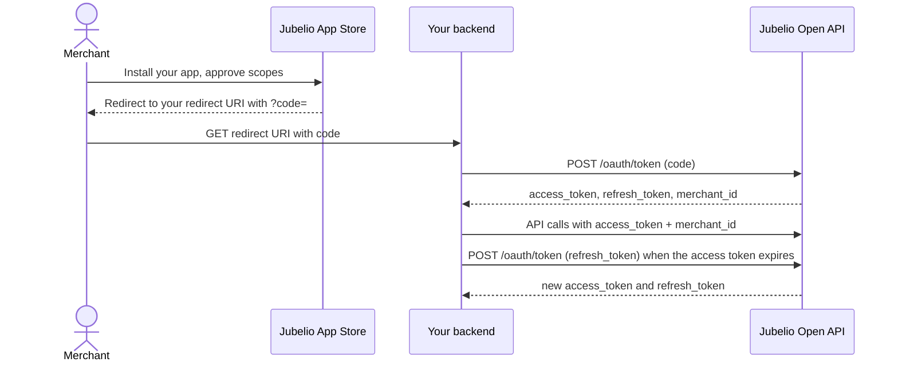

# Authentication

The Open API uses OAuth 2.0 with the authorization code flow. You get tokens when a merchant
installs your app, and refresh them as they expire.



## 1. Receive the authorization code

When a merchant installs your app, Jubelio redirects their browser to your redirect URI with a
`code` query parameter. The code is short lived and can be used once, so exchange it right away.

## 2. Exchange the code for tokens

Call `POST /oauth/token` from your backend with `grant_type: authorization_code`, the `code`, your
`client_id`, `client_secret` and `redirect_uri`. The response contains:

| Field | Use |
| ----- | --- |
| `access_token` | Sent on every API call. Expires after `expires_in` seconds. |
| `refresh_token` | Used to get a new access token. |
| `merchant_id` | The merchant who installed your app. Store your tokens under it. |
| `scopes` | The scopes the merchant approved. |

See [`POST /oauth/token`](/docs/api/auth/issue-access-token) in the API reference for the full request and response.

## 3. Call the API

Send two headers on every API call:

```http
Authorization: Bearer <access_token>
x-jbl-merchant-id: <merchant_id>
```

`x-jbl-merchant-id` is the `merchant_id` you received with the token. If your app is installed by
many merchants, always send the token and `merchant_id` of the same merchant.

## 4. Refresh the access token

When the access token expires, call `POST /oauth/token` with `grant_type: refresh_token`, the
`refresh_token`, your `client_id` and `client_secret`. You receive a new access token **and a new
refresh token**. Always save the new refresh token and use it next time.

## Errors

| Status | `error.code` | What to do |
| ------ | ------------ | ---------- |
| 400 | `missing_merchant` | Add the `x-jbl-merchant-id` header. |
| 401 | `invalid_token` | Refresh the token, and check the token and `merchant_id` belong to the same merchant. |
| 402 | `subscription_inactive` | The merchant's subscription to your app is not active. |
| 403 | `endpoint_not_authorized` | Your app does not have the scope this endpoint needs. |

## Good practice

- Make every call from your backend. Never expose tokens or your client secret in a browser.
- Do not put tokens in URLs or logs.
