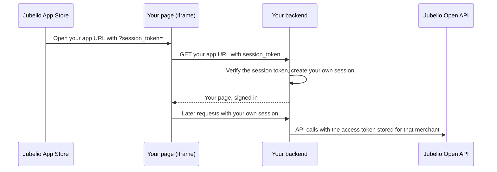

# Embedded apps

An embedded app opens inside the Jubelio App Store, in an iframe pointed at your app URL. Your
page runs on your own domain, so it cannot see the merchant's Jubelio login. Jubelio gives your
app a **session token** instead.

## What the session token is for

The session token tells your app which merchant user is opening it. Use it the way you would use
a login: your backend verifies it once, then creates its own session for that user, and from then
on your app works with its own session.

This is the recommended way to build an embedded app. Do not ask for a session token on every
request to your backend.

The session token only says who is viewing. It is not accepted by the Open API. To read or write
merchant data, your backend uses the access token from the install, as described in
[Authentication](./authentication.md).



## 1. Receive the session token on launch

Every time a merchant opens your app, the App Store loads your app URL with a fresh session
token in the query string:

```
https://your-app.example.com/?session_token=eyJhbGciOiJIUzI1NiIsInR5cCI6IkpXVCJ9...
```

On your server, when the request carries `session_token`:

1. Verify it, as described in [Verify the session token](#3-verify-the-session-token).
2. Create your own session for that `merchant_id` and `sub`.
3. Redirect to the same URL without `session_token`, so it does not end up in your analytics,
   logs or browser history.

```js
app.get('/', (req, res, next) => {
  const sessionToken = req.query.session_token;
  if (!sessionToken) return next();

  const claims = verifySessionToken(sessionToken);
  createAppSession(res, claims);
  res.redirect('/');
});
```

Do not log the query string of this request.

## 2. Get a new session token with postMessage

Your own session can be gone while your app is still open, for example after the merchant reloads
the page or when your session expires. The token from the launch URL is no longer usable by then,
so ask the App Store for a new one.

Send this message to the parent window:

```json
{
  "type": "jubelio.session_token.request"
}
```

Always pass the Jubelio App Store origin, `https://app-store.jubelio.com`, as the target origin,
never `*`. That way the message is only delivered if your page really is inside the Jubelio
App Store.

On success the App Store replies with:

```json
{
  "type": "jubelio.session_token",
  "session_token": "eyJhbGciOiJIUzI1NiIsInR5cCI6IkpXVCJ9...",
  "expires_in": 120
}
```

If it cannot issue a token, it replies with:

```json
{
  "type": "jubelio.session_token.error",
  "error": "app_not_installed"
}
```

| `error` | Meaning |
| ------- | ------- |
| `app_not_installed` | Your app is not installed for this merchant. |
| `unauthenticated` | The merchant's Jubelio login has expired. |

The App Store does not reply at all when your page origin does not match the app URL registered
for your app. Use a timeout so your page does not wait forever.

Before you trust a reply, check that `event.origin` is the Jubelio App Store origin and
`event.source` is `window.parent`. Ignore every other message.

```js
const JUBELIO_ORIGIN = 'https://app-store.jubelio.com';

export function getSessionToken(timeoutMs = 5000) {
  return new Promise((resolve, reject) => {
    const timer = setTimeout(() => {
      window.removeEventListener('message', onMessage);
      reject(new Error('session token request timed out'));
    }, timeoutMs);

    function onMessage(event) {
      if (event.origin !== JUBELIO_ORIGIN || event.source !== window.parent) return;
      const msg = event.data;

      if (msg?.type === 'jubelio.session_token') {
        clearTimeout(timer);
        window.removeEventListener('message', onMessage);
        resolve(msg.session_token);
      } else if (msg?.type === 'jubelio.session_token.error') {
        clearTimeout(timer);
        window.removeEventListener('message', onMessage);
        reject(new Error(msg.error));
      }
    }

    window.addEventListener('message', onMessage);
    window.parent.postMessage({ type: 'jubelio.session_token.request' }, JUBELIO_ORIGIN);
  });
}

const sessionToken = await getSessionToken();
await fetch('/session', {
  method: 'POST',
  headers: { Authorization: `Bearer ${sessionToken}` },
});
```

Your `/session` endpoint verifies the token and creates your own session, the same way as on
launch.

## 3. Verify the session token

The session token is a JWT signed with HS256 using your client secret. It lives for 2 minutes and
carries these claims:

| Claim | Meaning |
| ----- | ------- |
| `iss` | Jubelio, the issuer. |
| `aud` | Your Client ID. |
| `sub` | The merchant user viewing your app. |
| `merchant_id` | The merchant viewing your app. |
| `jti` | Unique per token. |
| `iat`, `exp` | Issued at, and 2 minutes later. |

On your backend:

1. Verify the signature with your client secret. Accept only HS256.
2. Check `exp`, allowing up to 10 seconds of clock skew.
3. Check that `aud` is your Client ID.
4. Store `jti` until the token expires, and reject a token you have already seen. A session token
   is meant to be used once.

```js
import jwt from 'jsonwebtoken';

function verifySessionToken(sessionToken) {
  return jwt.verify(sessionToken, process.env.JUBELIO_CLIENT_SECRET, {
    algorithms: ['HS256'],
    audience: process.env.JUBELIO_CLIENT_ID,
    clockTolerance: 10,
  });
}
```

## 4. Manage your own session

- **Create a new session on every launch.** Jubelio does not tell your app when a user signs out,
  loses access to the merchant, or uninstalls your app. A fresh session per launch keeps your app
  close to what is true in Jubelio. Keep your session short, a few hours at most.
- **Tie your session to `merchant_id` and `sub`.** If a new session token names a different
  merchant or user than your current session, drop the old session and use the new one. One
  browser can open your app for several merchants, and mixing them up shows one merchant's data
  to another.
- **Do not rely on plain cookies.** Inside the App Store your app runs as a third party, and
  browsers block or partition third party cookies. Either keep your own token in memory and send
  it in the `Authorization` header, or set your cookie with `SameSite=None; Secure; Partitioned`.
