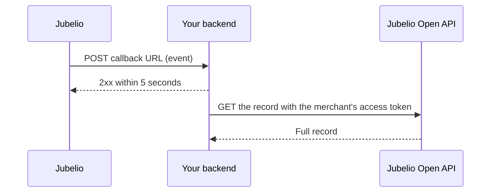

# Webhooks

Webhooks tell your app when data changes in a merchant's store, so you do not have to poll the API.
Jubelio sends an HTTPS `POST` to your callback URL for every event your app subscribes to, for every
merchant that installed your app.



## Set up

1. **Callback URL.** Set it in Dev Console. It must be HTTPS. You can change it at any time without a
   new app version.
2. **Secret.** Optional. If you set one, Jubelio sends it in the `X-Jubelio-Secret` header so you can
   check the request came from us.
3. **Events.** Pick them in your app version. Merchants approve the events together with the version,
   so adding an event needs a new version.

## Events

Each event has its own page with a payload example for every action.

| Event code | Sent when |
| --- | --- |
| [`invoice`](./events/invoice.md) | An invoice is created or changed |
| [`payment`](./events/payment.md) | A payment is created or changed |
| [`product`](./events/product.md) | A product is created, changed or deleted |
| [`price`](./events/price.md) | A product price changes |
| [`purchase_order`](./events/purchase-order.md) | A purchase order is created, changed or deleted |
| [`purchase_return`](./events/purchase-return.md) | A purchase return is created, changed or deleted |
| [`sales_return`](./events/sales-return.md) | A sales return is created |

Each delivery has an `action`:

| Action | Meaning |
| --- | --- |
| `updated` | The record was created or changed |
| `deleted` | The record was deleted |

## Payload

Every event uses the same envelope. Only `event_code`, `action` and the id inside `data` change.

```json
{
  "event_id": "3f6c1e2a-9b4d-4c7e-8a51-2d0f7b9e6c13",
  "event_code": "invoice",
  "action": "updated",
  "merchant_id": "7K2QX9M4BDH3",
  "timestamp": "2026-09-15T10:14:22.481Z",
  "data": {
    "invoice_id": 8891
  }
}
```

| Field | Description |
| --- | --- |
| `event_id` | Unique id of this event. The same on every retry. |
| `event_code` | The event your app subscribed to. |
| `action` | `updated` or `deleted`. |
| `merchant_id` | The merchant the change belongs to. Use it with that merchant's access token. |
| `timestamp` | When the change happened, in UTC. |
| `data` | The id of the changed record. The field name depends on the event. |

The payload carries only the record id. To read the record, call the API with the access token and
`x-jbl-merchant-id` of that merchant. Your app needs the scope for that endpoint.

## Headers

| Header | Description |
| --- | --- |
| `Content-Type` | `application/json` |
| `X-Jubelio-Event-Id` | Same as `event_id`. |
| `X-Jubelio-Event-Code` | Same as `event_code`. |
| `X-Jubelio-Timestamp` | Same as `timestamp`. |
| `X-Jubelio-Attempt` | `1` on the first try, higher on a retry. |
| `X-Jubelio-Secret` | Your secret. Sent only if you set one. |

## Verify the request

If you set a secret, compare `X-Jubelio-Secret` with your stored secret using a constant time compare,
and reject the request when they differ.

The secret proves the request came from Jubelio, but it is not a signature over the body. Keep your
callback URL on HTTPS and never log the header.

When you change the secret in Dev Console, deliveries sent before you save it still carry the old
value. Accept both for a short while when you rotate it.

## Respond

Return any `2xx` status within **5 seconds**. Do the real work after you respond, for example on your
own queue.

| Your response | What Jubelio does |
| --- | --- |
| `2xx` | Done. |
| Timeout, connection error, `5xx`, `408`, `429` | Retries (see below). |
| Any other status, including redirects | Gives up on this event. |

Jubelio does not follow redirects. Point your callback URL at the final address.

## Retries

A failed delivery is retried up to 2 more times, so each event is tried **at most 3 times**:

| Attempt | When |
| --- | --- |
| 1 | Right away |
| 2 | About 1 minute later |
| 3 | About 5 minutes after attempt 2 |

Every attempt carries the same `event_id`. After the third failed attempt the event is dropped.

## Good practice

1. **Deduplicate by `event_id`.** The same event can arrive more than once.
2. **Do not rely on order.** Events can arrive in any order. Compare `timestamp`, or read the latest
   record from the API.
3. **Reconcile now and then.** Delivery is best effort, so an event can be missed. If your app must
   stay in sync, compare your data with the API on a schedule.
4. **Expect events to stop** when a merchant uninstalls your app or their subscription is no longer
   active, the same moment API calls for that merchant stop working.
